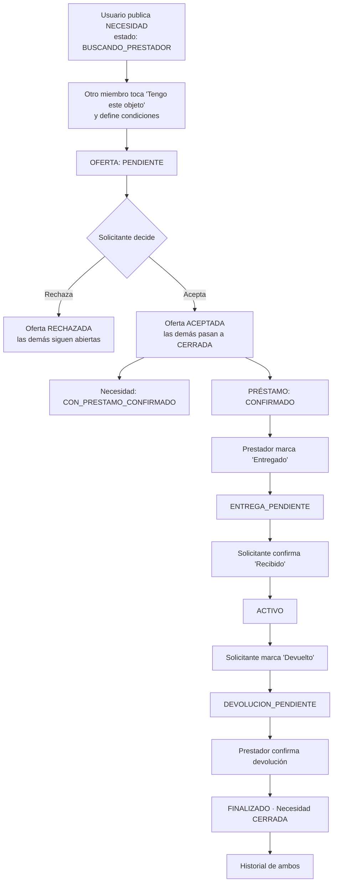
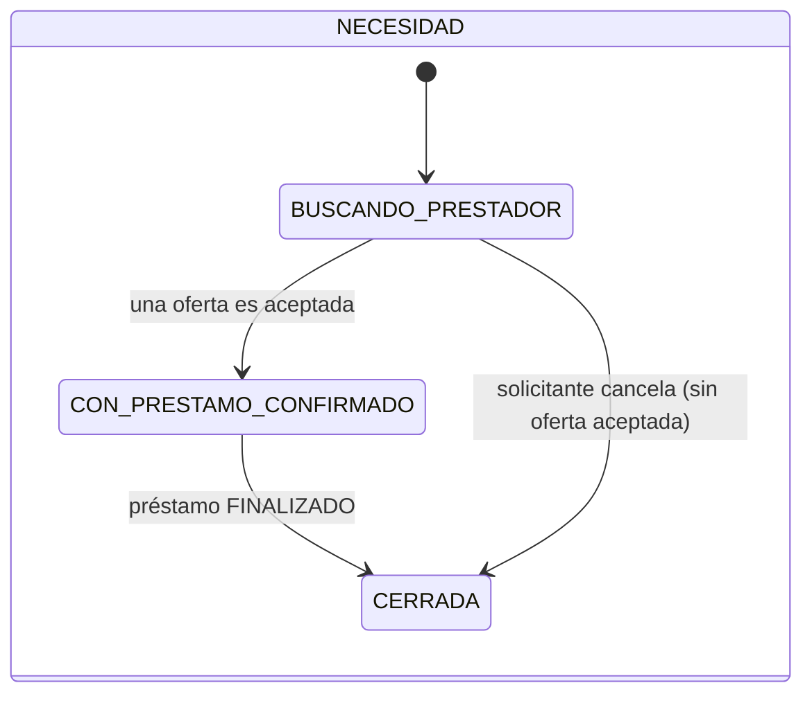
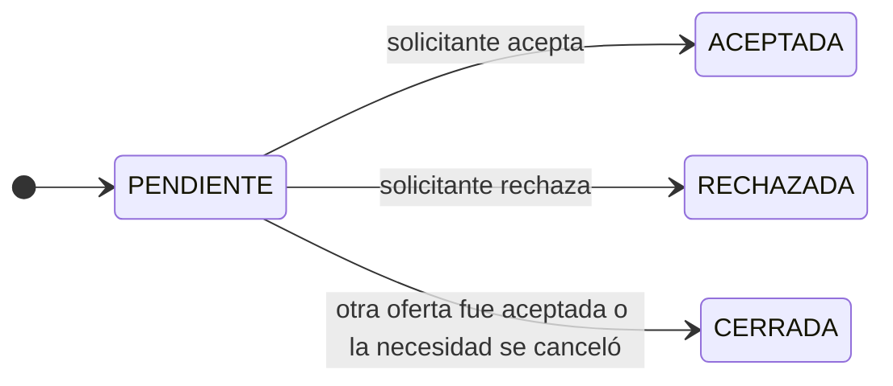
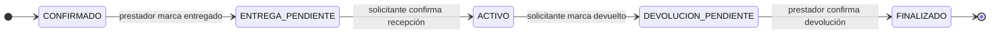
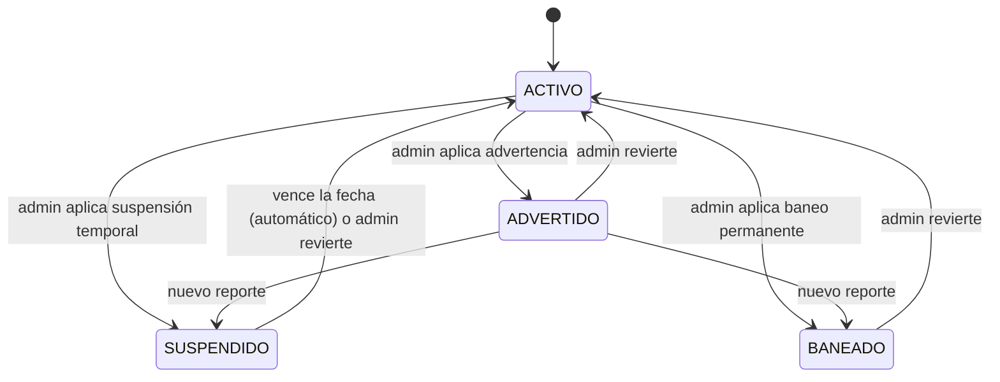
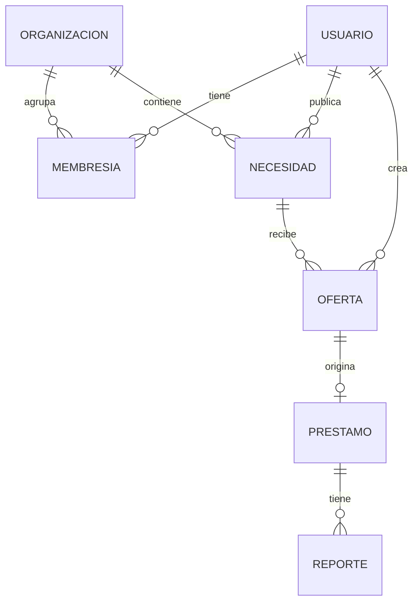

# SRS DEFINITIVO · BORROWAPP

**Plataforma de Préstamo y Alquiler de Objetos entre Comunidades**

| Campo | Valor |
|---|---|
| Materia | Desarrollo de Software |
| Docente | Prof. Marco Almanza Ibarra |
| Equipo | Jesús Vergara, Camilo Junco, Abraham Márquez |
| Versión | 1.1 (definitiva, consolida v1.0 + todas las correcciones acordadas) |
| Idioma de la interfaz | Español de Colombia |

---

## 0. INSTRUCCIONES PARA LA IA QUE USE ESTE DOCUMENTO

Este documento es la **fuente única de verdad** del proyecto. Si lo recibes como contexto:

1. **No inventes funcionalidades** que no estén aquí. Si algo no está definido, pregunta antes de asumir.
2. **Respeta la lista de exclusiones** de la sección 2. Nunca propongas chat, mapas, QR, pagos en la app, fotos, calificaciones con estrellas ni IA.
3. **Respeta el stack**: Flutter + Dart (app), API REST propia (backend), PostgreSQL (base de datos). Hosting gratuito o de bajo costo (Railway, Render, Vercel).
4. **Todo es por organización.** Rol, estado/sanciones e identificador interno viven en la *membresía* (usuario + organización), nunca en la cuenta global.
5. **Usa exactamente los nombres de estados y botones** de este documento (secciones 7 y 12).
6. **Los préstamos nunca avanzan sin la doble confirmación** de las dos partes.
7. **La app nunca mueve dinero ni controla la entrega física.** Solo registra.
8. Los textos de interfaz van en **español de Colombia**.

---

## 1. RESUMEN DEL PRODUCTO

BorrowApp es una app móvil (Android/iOS) donde los miembros de **comunidades cerradas** (universidad, empresa o conjunto residencial) se prestan o alquilan objetos entre sí.

- Cada comunidad es una **Organización**. Solo sus miembros se ven e interactúan entre ellos.
- Crear una organización genera un **código de 5 caracteres** (como el código de una clase de Google Classroom) y convierte al creador en su **administrador**.
- Los demás se unen ingresando ese código.
- Un usuario puede estar en **varias organizaciones** a la vez; siempre hay una **organización activa** que determina lo que ve.
- Cualquier miembro puede **pedir** (publicar una necesidad) y **ofrecer** (responder con "Tengo este objeto"). No hay roles fijos de "solo presta" o "solo pide".
- Quien ofrece **define las condiciones** (gratis o alquiler, precio por hora o por día, fecha y hora de entrega). Quien pidió **acepta o rechaza**.
- La entrega y la devolución ocurren **en persona**, en el **punto central** de la organización, y la app las registra con **doble confirmación**.
- Si hay problemas, se **reporta** al administrador de esa organización, que puede **sancionar**.

---

## 2. ALCANCE

### Incluye
Flujo completo: necesidad → oferta → aceptación → préstamo → entrega → uso → devolución → historial, más organizaciones, reportes, sanciones y panel de administración.

### NO incluye (restricciones duras)
- Pagos, tarjetas o billeteras dentro de la app (todo cobro se paga en persona).
- Chat, videollamadas o mensajería.
- Geolocalización, mapas, seguimiento en tiempo real. El punto central es **solo texto**.
- Códigos QR.
- Domicilios o repartidores.
- Recomendaciones o clasificación con IA.
- Verificación de identidad con documentos.
- Reputación avanzada (calificaciones con estrellas), multas automáticas, depósitos de garantía.
- Subida de fotos de objetos (los objetos se representan con ícono de categoría).
- Transferir el rol de administrador o nombrar administradores adicionales.

---

## 3. GLOSARIO

| Término | Definición |
|---|---|
| **Organización** | Comunidad cerrada (universidad, empresa o conjunto residencial) identificada por un código de acceso único. |
| **Código de acceso** | Exactamente 5 caracteres alfanuméricos en mayúsculas, generado automáticamente al crear la organización, único en todo el sistema. Recomendación de implementación: excluir caracteres ambiguos (0/O, 1/I/L). |
| **Membresía** | Relación usuario–organización. Guarda **rol**, **estado** e **identificador interno** propios de esa organización. |
| **Organización activa** | La organización seleccionada en la sesión; filtra qué ve el usuario. Cambiarla no modifica ninguna membresía. |
| **Identificador interno** | Código estudiantil (universidad), código de empleado (empresa) o número de apartamento (conjunto). Texto libre, no se valida contra sistemas externos. |
| **Necesidad** | Publicación de un usuario: qué objeto necesita, descripción, fecha de inicio y de fin. |
| **Oferta** | Respuesta ("Tengo este objeto") con las condiciones definidas por el prestador. |
| **Préstamo** | Acuerdo creado al aceptar una oferta. Avanza con confirmaciones de ambas partes. |
| **Solicitante** | Quien publicó la necesidad y recibe el objeto. |
| **Prestador** | Quien ofreció el objeto. |
| **Punto central** | Lugar único por organización (texto) donde se hacen todas las entregas y devoluciones. |
| **Reporte** | Aviso de problema sobre un préstamo (objeto no devuelto, dañado o inasistencia). |
| **Sanción** | Advertencia, suspensión temporal o baneo permanente aplicada por el administrador, solo dentro de esa organización. |

---

## 4. ORGANIZACIONES, ROLES Y MEMBRESÍAS

### Reglas
1. Un usuario tiene **una membresía por organización** y puede tener varias simultáneas.
2. Cada membresía guarda: **rol** (Administrador | Miembro), **estado** (Activo | Advertido | Suspendido | Baneado) e **identificador interno**.
3. El **Administrador** es únicamente quien **creó** la organización, y solo dentro de ella. En otras organizaciones ese mismo usuario es Miembro.
4. Un administrador es un usuario normal con funciones extra (panel de administración) en su organización.
5. Una sanción en una organización **no afecta** las demás.
6. Para unirse se ingresa el código y luego el identificador interno, cuya etiqueta cambia según el tipo de organización.

### Ejemplo
```
Jesús Vergara
 ├─ Membresía 1: Universidad Tecnológica de Bolívar (código K7Q4X)
 │    rol: Administrador · estado: Activo · identificador: T00061234
 └─ Membresía 2: Torres del Parque (código M2X9P)
      rol: Miembro · estado: Activo · identificador: Apto 502
```

### Permisos por rol (dentro de cada organización)

| Rol | Puede |
|---|---|
| **Miembro** | Registrarse; crear o unirse a organizaciones; publicar y consultar necesidades; ofrecer objetos; aceptar o rechazar ofertas recibidas; confirmar entregas y devoluciones; reportar problemas; ver historial y estadísticas; cambiar organización activa; cancelar sus necesidades. |
| **Administrador** | Todo lo del Miembro, más: ver miembros, publicaciones y préstamos de su organización; atender reportes; aplicar y revertir sanciones; modificar el punto central; ver y copiar el código de la organización. |

---

## 5. FLUJO COMPLETO DEL NEGOCIO



### Pasos
1. **Registro e ingreso.** El usuario se registra y luego crea una organización o se une con un código de 5 caracteres.
2. **Publicar necesidad.** Objeto, descripción, fecha de inicio y fin. Visible solo en la organización activa. Estado inicial: `BUSCANDO_PRESTADOR`.
3. **Ofrecer.** Cualquier otro miembro con ese objeto toca **"Tengo este objeto"** y **él define** las condiciones: préstamo gratuito o alquiler; si es alquiler, precio y unidad (por hora o por día); fecha y hora de entrega. El punto de entrega es el punto central (solo lectura). Se crea una oferta `PENDIENTE`.
4. **Decidir.** El solicitante ve las "Condiciones propuestas" y por cada una elige **Aceptar condiciones** o **Rechazar**. Rechazar no cierra la necesidad.
5. **Aceptar.** Se pide confirmación ("¿Aceptar estas condiciones?"). Al confirmar: las demás ofertas pendientes pasan a `CERRADA`, la necesidad pasa a `CON_PRESTAMO_CONFIRMADO` y se crea el préstamo `CONFIRMADO` (objeto, prestador, solicitante, fechas, modalidad, precio total, punto central).
6. **Entrega (en persona, en el punto central).** El prestador marca "Entregado" → `ENTREGA_PENDIENTE`. El solicitante confirma "Recibido" → `ACTIVO`. Sin ambas confirmaciones no avanza.
7. **Devolución (en persona, en el punto central).** El solicitante marca "Devuelto" → `DEVOLUCION_PENDIENTE`. El prestador confirma → `FINALIZADO`. La necesidad pasa a `CERRADA`.
8. **Historial.** Todo queda registrado para ambos, indicando su papel (Solicitante o Prestador).
9. **Problemas.** En cualquier momento entre `CONFIRMADO` y `DEVOLUCION_PENDIENTE`, cualquiera de las partes puede reportar. El préstamo muestra **"En conflicto"** hasta que el administrador resuelva (ver sección 6.2).

---

## 6. MÁQUINAS DE ESTADO

### 6.1 Necesidad y Oferta





### 6.2 Préstamo



**"En conflicto" NO es un estado de la cadena.** Es una **marca superpuesta** que se muestra mientras exista un reporte `PENDIENTE` sobre el préstamo. Por debajo, el préstamo conserva su estado real. Al resolverse el reporte, la marca desaparece y el préstamo continúa su flujo normal hasta `FINALIZADO`. En la interfaz se muestra el chip rojo "En conflicto" con un banner: *"Se reportó un problema. El administrador lo está revisando"*.

### 6.3 Membresía (estado del usuario en una organización)



Este estado es **independiente en cada organización**.

---

## 7. REQUISITOS FUNCIONALES

Prioridades: **Alta** = imprescindible · **Media** = importante · **Baja** = deseable.

| ID | Nombre | Descripción | Prioridad |
|---|---|---|---|
| RF-001 | Registro de usuario | Registrarse con nombre completo, correo único y contraseña de mínimo 8 caracteres. | Alta |
| RF-002 | Inicio de sesión | Autenticar con correo y contraseña; mantener sesión con token. | Alta |
| RF-003 | Creación de organización | Crear una organización con nombre, tipo (universidad, empresa o conjunto residencial), punto central y el identificador interno del creador. El sistema genera un código de 5 caracteres alfanuméricos en mayúsculas, único en todo el sistema, y asigna al creador como administrador mediante una membresía. | Alta |
| RF-004 | Unión a organización mediante código | Ingresar el código de 5 caracteres para unirse, indicando el identificador interno (código estudiantil, de empleado o número de apartamento según el tipo). Si el código no existe, rechazar e indicarlo. Un usuario puede tener membresías en varias organizaciones. | Alta |
| RF-005 | Restricción por organización | Consulta de necesidades, creación de ofertas y participación en préstamos solo entre usuarios con membresía activa en la misma organización, es decir, la organización activa. | Alta |
| RF-006 | Publicación de necesidad | Publicar una necesidad en la organización activa con objeto, descripción, fecha de inicio y de fin. Se crea en `BUSCANDO_PRESTADOR`. | Alta |
| RF-007 | Consulta de necesidades | Listar las necesidades de la organización activa con objeto, fechas y estado. | Alta |
| RF-008 | Creación de oferta | Cualquier miembro distinto del solicitante puede responder con "Tengo este objeto", definiendo él mismo: modalidad (gratuito o alquiler); si es alquiler, precio y unidad (hora o día); y fecha y hora de entrega. La oferta nace `PENDIENTE`. | Alta |
| RF-009 | Cálculo del precio | En alquiler: total = precio × duración (horas o días). En gratuito: total = $0. | Media |
| RF-010 | Aceptación o rechazo de ofertas | El solicitante consulta las ofertas y acepta o rechaza cada una. Al aceptar, las demás ofertas pendientes pasan a `CERRADA`. Rechazar no cierra la necesidad ni las demás ofertas. | Alta |
| RF-011 | Creación del préstamo | Al aceptar una oferta se crea un préstamo `CONFIRMADO` con objeto, prestador, solicitante, fechas, modalidad, precio y punto central. | Alta |
| RF-012 | Confirmación de entrega y recepción | El prestador marca "Entregado" y el solicitante confirma "Recibido". Pasa a `ACTIVO` solo con ambas. | Alta |
| RF-013 | Confirmación de devolución | El solicitante marca "Devuelto" y el prestador confirma. Pasa a `FINALIZADO` solo con ambas. | Alta |
| RF-014 | Reporte de problemas | Cualquiera de las dos partes reporta (objeto no devuelto, dañado o inasistencia). El reporte llega al panel del administrador de la organización del préstamo. | Media |
| RF-015 | Historial | Mostrar historial de necesidades, ofertas y préstamos, diferenciando el papel (Solicitante o Prestador), con estadísticas básicas. | Media |
| RF-016 | Panel de administración | El administrador consulta miembros, publicaciones y préstamos de su organización, atiende reportes y modifica el punto central. | Media |
| RF-017 | Aplicación de sanciones | Al revisar un reporte, el administrador aplica advertencia, suspensión temporal (con fecha de fin) o baneo permanente. Se actualiza el estado de la membresía (`ADVERTIDO`, `SUSPENDIDO`, `BANEADO`), el reporte pasa a `RESUELTO` y se guarda administrador, fecha y nota de resolución. Puede revertir la sanción devolviendo la membresía a `ACTIVO`. | Alta |
| RF-018 | Restricciones a usuarios sancionados | Un usuario `SUSPENDIDO` o `BANEADO` en una organización no puede publicar necesidades, crear ofertas ni aceptar ofertas en ella, y ve un mensaje con el motivo. No afecta sus otras organizaciones. Sus préstamos en curso continúan normalmente. Al vencer una suspensión, vuelve a `ACTIVO` automáticamente. | Alta |
| RF-019 | Cambio de organización activa *(nuevo)* | Elegir cuál organización es la activa. Todas las pantallas reflejan solo esa organización. No altera rol, estado ni identificador de ninguna membresía. | Media |
| RF-020 | Cancelación de necesidad *(nuevo)* | El solicitante puede cancelar una necesidad en `BUSCANDO_PRESTADOR` sin oferta aceptada. Pasa a `CERRADA` y sus ofertas pendientes pasan a `CERRADA`. Con préstamo confirmado no se puede cancelar. | Media |

---

## 8. REQUISITOS NO FUNCIONALES

| ID | Categoría | Descripción | Prioridad |
|---|---|---|---|
| RNF-001 | Rendimiento | Registrar una necesidad, oferta o confirmación en menos de 5 segundos con conexión móvil estándar. | Alta |
| RNF-002 | Seguridad | Contraseñas con hash (bcrypt o equivalente); toda comunicación por HTTPS. | Alta |
| RNF-003 | Disponibilidad | Debe responder correctamente con varios usuarios operando en simultáneo. | Media |
| RNF-004 | Usabilidad | Un usuario nuevo publica su primera necesidad u oferta en menos de 3 minutos sin ayuda. | Alta |
| RNF-005 | Escalabilidad | Agregar organizaciones, y que un usuario se una a varias, sin cambiar el modelo de datos ni la lógica existente. | Baja |
| RNF-006 | Mantenibilidad | Backend organizado para facilitar mantenimiento y extensión. | Alta |
| RNF-007 | Consistencia *(nuevo)* | Transiciones de estado atómicas: nunca dos ofertas `ACEPTADA` en la misma necesidad ni un préstamo que avance sin sus confirmaciones completas. | Alta |

---

## 9. REGLAS DE NEGOCIO (resumen sin ambigüedad)

1. Una membresía por usuario y organización; rol, estado e identificador son independientes por organización.
2. Código de organización: 5 caracteres alfanuméricos en mayúsculas, único.
3. Solo el creador es administrador; no se transfiere ni se asignan más.
4. Cualquier miembro activo puede pedir y ofrecer; solicitante y prestador son papeles por operación.
5. El **prestador** define las condiciones; el **solicitante** acepta o rechaza.
6. Aceptar una oferta cierra automáticamente las demás ofertas pendientes de esa necesidad.
7. Ningún préstamo avanza sin las dos confirmaciones correspondientes.
8. "En conflicto" es una marca superpuesta, no un estado; el préstamo retoma su estado real al resolverse el reporte.
9. Las sanciones son por organización y no se propagan a otras.
10. Los préstamos activos de un sancionado continúan; no se afectan retroactivamente.
11. La suspensión temporal termina sola al llegar su fecha de fin.
12. La app nunca mueve dinero; los pagos son en persona.
13. Entregas y devoluciones siempre en el punto central de la organización.
14. El punto central se muestra solo como texto; al modificarlo, aplica a **préstamos nuevos**.

---

## 10. MODELO DE DATOS



| Entidad | Atributos principales |
|---|---|
| **USUARIO** | id, nombre completo, correo (único), contraseña (hash), fecha de registro |
| **ORGANIZACION** | id, nombre, tipo (UNIVERSIDAD / EMPRESA / CONJUNTO_RESIDENCIAL), código de acceso (5 car., único), punto central, administrador_id, fecha de creación |
| **MEMBRESIA** | id, usuario_id, organizacion_id, rol (ADMINISTRADOR / MIEMBRO), estado (ACTIVO / ADVERTIDO / SUSPENDIDO / BANEADO), identificador interno, fecha fin de suspensión, fecha de ingreso. Único (usuario_id, organizacion_id) |
| **NECESIDAD** | id, organizacion_id, solicitante_id, objeto, descripción, fecha inicio, fecha fin, estado, fecha de publicación |
| **OFERTA** | id, necesidad_id, prestador_id, modalidad (GRATIS / ALQUILER), precio, unidad (HORA / DIA), total, fecha y hora de entrega, estado |
| **PRESTAMO** | id, necesidad_id, oferta_id, organizacion_id, solicitante_id, prestador_id, modalidad, precio total, punto central (copiado al crear), estado, confirmación entrega (prestador), confirmación recepción (solicitante), confirmación devuelto (solicitante), confirmación recibido (prestador), marcas de tiempo |
| **REPORTE** | id, prestamo_id, reportante_id, reportado_id, tipo (NO_DEVUELTO / DAÑADO / INASISTENCIA), descripción, estado (PENDIENTE / RESUELTO), sanción aplicada, admin_resolutor_id, nota de resolución, fecha |

---

## 11. INTERFAZ: NAVEGACIÓN Y COMPORTAMIENTO

### Navegación
- **Barra inferior fija con 5 pestañas:** Inicio, Necesidades, Mis préstamos, Historial, Perfil. Visible en pantallas principales; **no** en formularios, acceso ni panel de administración.
- **Selector de organización:** píldora arriba en Inicio, Necesidades, Mis préstamos e Historial, con el nombre de la organización activa y una flecha. Abre un bottom sheet "Tus organizaciones" (ícono, nombre, tipo, chip Admin/Miembro, marca en la activa, botones "Unirme con un código" y "Crear una organización").
- **Código de organización:** siempre en 5 casillas individuales, mayúsculas, monoespaciado.
- El **Panel de administración** solo aparece en el Perfil de una organización donde el usuario es administrador.

### Chips de estado
- **Préstamo:** Confirmado, Entrega pendiente, Activo, Devolución pendiente, Finalizado, En conflicto.
- **Necesidad:** Buscando prestador, Con préstamo confirmado, Cerrada.
- **Oferta:** Pendiente, Aceptada, Rechazada, Cerrada.
- **Usuario:** Activo, Advertido, Suspendido, Baneado.
- **Modalidad:** Gratis, Alquiler. **Papel:** Solicitante, Prestador. **Rol en organización:** Admin, Miembro.

### Bloque A · Acceso y organizaciones
1. **Bienvenida:** logo, lema "Comparte lo que tienes, encuentra lo que necesitas", botones "Crear cuenta" e "Iniciar sesión".
2. **Registro:** nombre completo, correo, contraseña (mostrar/ocultar, indicador "Mínimo 8 caracteres").
3. **Inicio de sesión:** correo y contraseña.
4. **Sin organización** (primera vez): tarjetas "Unirme con un código" y "Crear mi organización".
5. **Unirme, paso 1:** 5 casillas para el código. Error: "Este código no corresponde a ninguna organización".
6. **Unirme, paso 2:** vista previa de la organización encontrada (nombre, tipo, punto central) y campo del identificador con etiqueta según el tipo ("Código estudiantil", "Código de empleado" o "Número de apartamento"). Botón "Unirme".
7. **Crear organización:** nombre, tipo (3 tarjetas), punto central, identificador del admin. Botón "Crear organización".
8. **Organización creada:** código generado en 5 casillas, "Copiar", "Compartir", aviso "Eres el administrador de esta organización", botón "Ir al inicio".

Los pasos 5 a 8 se reutilizan cuando un usuario con organizaciones quiere unirse a otra o crear otra.

### Bloque B · Necesidades y ofertas
1. **Inicio:** píldora de organización, "Hola, [nombre]", botón "Publicar una necesidad", tarjetas "Préstamos activos", "Acciones pendientes", "Ofertas recibidas", y "Necesidades recientes de tu comunidad".
2. **Selector de organización** (bottom sheet).
3. **Necesidades:** pestañas "De la comunidad", "Mis necesidades", "Mis ofertas"; filtros por estado; botón flotante "+ Publicar".
4. **Publicar necesidad:** Objeto que necesitas, Descripción, Fecha de inicio, Fecha de fin.
5. **Detalle de necesidad de otro miembro:** botón fijo "Tengo este objeto" y nota "Tú defines si lo prestas gratis o lo alquilas".
6. **Definir mis condiciones:** "Préstamo gratuito | Alquiler"; si es alquiler, Precio y "Por hora | Por día"; Fecha y hora de entrega; "Total calculado" (ej. "$10.000 x 3 días = $30.000", "$0" si es gratis); punto de entrega solo lectura; botón "Publicar mis condiciones".
7. **Oferta enviada:** resumen, chip "Pendiente", botón "Ver mis ofertas".
8. **Detalle de MI necesidad:** "Condiciones propuestas (N)" con prestador, chip Gratis/Alquiler, precio, total, fecha de entrega, botones "Aceptar condiciones" y "Rechazar". Opción para cancelar la necesidad si sigue en "Buscando prestador".
9. **Confirmar aceptación:** "¿Aceptar estas condiciones?", aviso "Las demás ofertas de esta necesidad se cerrarán automáticamente", botones "Cancelar" y "Sí, aceptar".
10. **Préstamo confirmado:** resumen y "Coordinen la entrega en el punto central", botón "Ver préstamo".

### Bloque C · Préstamos
- **Mis préstamos:** pestañas "En curso" y "Finalizados". Cada tarjeta: objeto, contraparte, fechas, chips de papel, modalidad y estado. Si el usuario debe actuar, línea destacada, p. ej. "Te toca confirmar la recepción".
- **Detalle de préstamo** (estructura común): encabezado con objeto y chip de estado; **stepper de 5 pasos** (Confirmado, Entrega, Activo, Devolución, Finalizado); resumen (solicitante, prestador, fechas, modalidad, precio total); tarjeta "Punto central"; tarjeta "Confirmaciones" con una fila por parte (confirmado o pendiente) dejando claro que se necesitan **ambas**; enlace "Reportar un problema".

| Estado | Vista | Botón primario |
|---|---|---|
| Confirmado | Prestador | "Marcar como entregado" |
| Entrega pendiente | Solicitante | "Confirmar recepción" |
| Activo | Solicitante | "Marcar como devuelto" (con fecha de devolución destacada) |
| Devolución pendiente | Prestador | "Confirmar devolución" |
| Finalizado | Ambos | Sin botones; mensaje "Préstamo completado" |
| En conflicto | Ambos | Banner "Se reportó un problema. El administrador lo está revisando" |

- **Reportar un problema:** préstamo asociado; opciones "El objeto no fue devuelto", "El objeto está dañado", "La otra persona no asistió"; descripción; aviso "Tu reporte será enviado al administrador de tu organización"; botón "Enviar reporte".

### Bloque D · Historial, perfil, organizaciones y sanciones
- **Historial:** 4 estadísticas ("Como prestador", "Como solicitante", "Finalizados", "En curso"); pestañas "Necesidades | Ofertas | Préstamos"; cada ítem con objeto, fecha, estado y papel.
- **Perfil (admin):** avatar, nombre, correo, tarjeta de la organización (nombre, tipo, chip Admin, identificador, punto central, código en 5 casillas con "Copiar"), estado, tarjeta "Panel de administración" con insignia de reportes pendientes, fila "Mis organizaciones (N)", "Cerrar sesión".
- **Perfil (miembro):** igual, **sin** panel de administración y **sin** código de la organización.
- **Mis organizaciones:** tarjeta por organización con tipo, rol, identificador, estado y botón "Cambiar a esta organización" (deshabilitado en la activa); botones "Unirme con un código" y "Crear otra organización"; nota "Tu estado y tu rol son independientes en cada organización".
- **Usuario suspendido:** banner fijo "Estás suspendido en [organización] hasta [fecha]. Motivo: [motivo]"; botones "Publicar", "Tengo este objeto" y "Aceptar condiciones" deshabilitados; notas "Tus préstamos activos continúan con normalidad" y "Esta suspensión no afecta tu cuenta en otras organizaciones".
- **Avisos por sanción:** Advertido ("Has recibido una advertencia del administrador"), Suspendido (con fecha de fin) y Baneado ("Fuiste retirado de esta organización de forma permanente"), cada uno con motivo y organización.

### Bloque E · Panel de administración (solo admin, solo en su organización)
1. **Panel:** nombre y código de la organización, tarjetas con contador "Miembros", "Publicaciones", "Préstamos", "Reportes" (con insignia de pendientes), y tarjeta "Punto central de entrega y devolución" con "Modificar".
2. **Miembros:** buscador y lista con identificador y chip de estado; el admin lleva etiqueta "Admin".
3. **Publicaciones:** todas las necesidades de la organización.
4. **Préstamos:** todos los préstamos, incluidos los "En conflicto".
5. **Reportes:** pestañas "Pendientes | Resueltos".
6. **Detalle de reporte y sanción:** datos del reporte; "Decisión": "Advertencia", "Suspensión temporal" (pide fecha de fin) o "Baneo permanente"; campo "Nota de resolución"; botón "Aplicar sanción"; diálogo de confirmación.
7. **Reporte resuelto:** sanción aplicada, administrador, fecha, nota, estado actual del usuario; botón "Revertir sanción" (con confirmación).
8. **Modificar punto central:** aviso "Este cambio aplicará a los nuevos préstamos de tu organización".

---

## 12. IDENTIDAD VISUAL (resumen; el detalle está en DESIGN.md)

- Concepto **"Marea"**: lo que sale, vuelve.
- Colores: **Laguna** `#0A5F5A` (primario), **Sol** `#FFC233` (acento solo para "requiere tu atención" y botón sobre degradado), fondo **Sal** `#F3F7F6`, texto **Tinta** `#0E1F1E`.
- Degradado "Marea": `#0A3634` → `#0A5F5A` → `#109588`, solo en Bienvenida, hero del Inicio, pantallas de éxito y organización creada.
- Tipografía: Bricolage Grotesque (títulos y cifras), Figtree (interfaz), JetBrains Mono (código de organización).
- Íconos Material Symbols Rounded. **Sin fotos ni emojis**: los objetos usan ícono de categoría sobre cuadrado de color.
- Cada organización tiene un color propio en su avatar.
- Los chips de estado siempre llevan ícono además de color.

---

## 13. TECNOLOGÍA Y RESTRICCIONES TÉCNICAS

- App móvil: **Flutter y Dart** (Android e iOS).
- Backend: **API REST propia** (HTTP + JSON).
- Base de datos: **PostgreSQL**.
- Seguridad: bcrypt (o equivalente) y HTTPS.
- Hosting gratuito o de bajo costo (Railway, Render, Vercel).
- Plazo: aproximadamente 14 semanas.

---

## 14. SUPUESTOS Y DEPENDENCIAS

- Los usuarios tienen smartphone e Internet.
- Cada organización define y mantiene su punto central.
- Los usuarios cumplen entre ellos los acuerdos de entrega, devolución y pago.
- El administrador comunica bien el código a sus miembros.
- Los objetos se prestan y se reciben en buenas condiciones.
- No hay organizaciones duplicadas.
- Una organización tiene un único administrador (su creador).
- No hay límite de organizaciones por usuario en el MVP.
- El identificador interno es texto libre, sin validación externa.

---

## 15. DATOS DE EJEMPLO (para prototipos y pruebas)

- **Usuarios:** Jesús Vergara (`jesus.vergara@correo.com`), Camilo Junco, Abraham Márquez, Laura Gómez.
- **Organización 1:** Universidad Tecnológica de Bolívar, tipo Universidad, código `K7Q4X`. Jesús es **Administrador**, identificador `T00061234`. Punto central: "Biblioteca Central, mostrador de atención".
- **Organización 2:** Torres del Parque, tipo Conjunto residencial, código `M2X9P`. Jesús es **Miembro**, identificador "Apto 502". Punto central: "Portería principal".
- **Objetos:** calculadora científica, taladro, cargador de portátil, proyector, bicicleta.
- **Precios:** "$3.000 / hora", "$10.000 / día"; gratis: "$0".
- **Suspensión de ejemplo:** hasta 30/09/2026, motivo "objeto no devuelto a tiempo".

---

## 16. DECISIONES DE DISEÑO TOMADAS (donde el SRS original era ambiguo)

| Tema | Decisión |
|---|---|
| "En conflicto" | Marca superpuesta mientras haya un reporte pendiente, no un estado de la cadena. El préstamo conserva su estado real. |
| Cierre de necesidad | `CERRADA` cuando el préstamo finaliza o cuando el solicitante cancela sin oferta aceptada (RF-020). |
| Rechazar una oferta | No cierra la necesidad; otros pueden seguir ofreciendo mientras esté en `BUSCANDO_PRESTADOR`. |
| Identificador interno | Se pide al unirse y al crear una organización, no en el registro. |
| Administrador | Único por organización (el creador); sin transferencia. |
| Cambio de punto central | Aplica solo a préstamos nuevos; cada préstamo conserva el punto con el que se creó. |
| Sanciones | Por membresía; no se propagan a otras organizaciones. |

---

## 17. DISCREPANCIAS ENTRE EL PROTOTIPO (Figma) Y ESTE SRS

Para revisar antes de implementar, porque el prototipo tiene elementos que el SRS no contempla:

1. **Calificación:** el detalle de necesidad del prototipo menciona "perfil y calificación" del solicitante. El SRS **excluye** calificaciones con estrellas. Quitarlo o decidir si se incluye.
2. **Catálogo de objetos comunes** en el Inicio ("Calculadora, Taladro, Cargador, Proyector", "Ver catálogo"): no está en el SRS. Decidir si se incluye como atajo o se elimina.
3. **Unidad de cobro:** la pantalla "Definir oferta" del prototipo muestra solo "Por día". El SRS exige **por hora o por día**.
4. **Código "opcional":** el prototipo dice "el código es opcional si aplica" en Unirme paso 1. Según el SRS el código es **obligatorio** para unirse.
5. **Tipo "condominio":** el prototipo usa "condominio"; el SRS dice "conjunto residencial". Unificar.
6. **Identificador del creador "opcional":** el prototipo lo marca opcional; el SRS lo trata como parte de la membresía. Decidir si es obligatorio.

---

## 18. CAMBIOS FRENTE A LA VERSIÓN 1.0

- RF-003, 004, 005, 008, 010, 016: reescritos para reflejar organizaciones múltiples, código de 5 caracteres y la mecánica real de las ofertas.
- RF-017 y RF-018: los **títulos estaban cruzados** (RF-017 describía aplicar sanciones y RF-018 el bloqueo de sancionados). Corregidos.
- RF-019 y RF-020: nuevos.
- RNF-005 ampliado y RNF-007 nuevo.
- Definido el modelo de **membresía** y **organización activa**.
- Definido que "En conflicto" es una marca y no un estado.
- Agregadas máquinas de estado, flujo completo, modelo de datos y reglas de negocio explícitas.
- Agregada la especificación de pantallas y el comportamiento de la interfaz.

---

*Fin del documento.*
